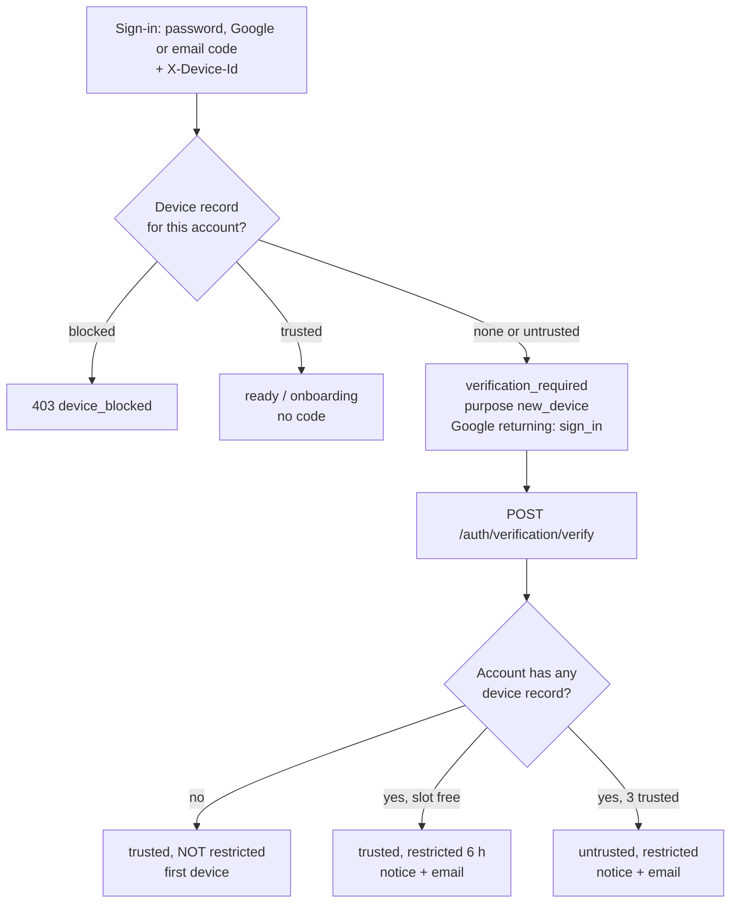
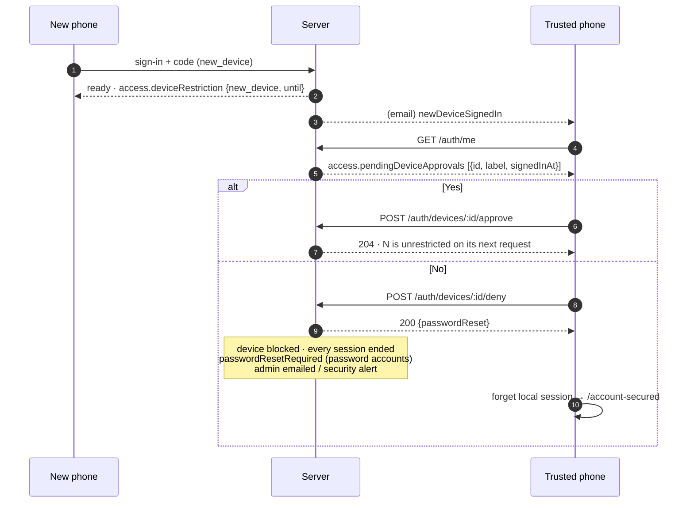

# Device trust — flow and API contract

How Leader decides whether a phone may open an account, what a new phone may
do in its first hours, and how the owner's other phones answer for it. The
server is the authority for every rule here; the app shows the state and
sends the answers. Source of truth for the wire: `Leader_backend/docs/api/auth.md`
→ "Device trust".

## Owner rulings (2026-10-08)

| # | Rule |
|---|---|
| 1 | The "الدخول برمز يصل إلى بريدك" button is gone from sign-in. `/otp` and every code endpoint stay. |
| 2 | Sessions: idle limit 7 days (`REFRESH_TOKEN_TTL_DAYS`, slid by every refresh and `GET /auth/me`), absolute limit `SESSION_MAX_DAYS` (30). |
| 3 | Offline: the phone opens the account offline only while now < last server contact + 7 days. Offline opens never extend it. |
| 4 | Device id: a random UUID v4 minted on first launch, in secure storage; the server keeps only a hash. Reinstall = new device. Sent on every request. |
| 5 | New device on an existing account: email code (10 min, single use, 5 attempts, hashed), then **restricted for 6 hours**, enforced on the server. |
| 6 | Trusted devices (max 3) see "a new device signed in" (in app + email). Yes lifts the restriction; No blocks the device and ends every session. |
| 7 | First device of an account (no device record): email code, no restriction, trusted. |
| 8 | The same rules for password, Google and email-code sign-in. "My devices" lists the devices and removes one. |
| Q2 | A 4th device: code every time, untrusted and restricted until a device is removed and a trusted device approves it. |
| Q3 | Google skips the code only on a trusted device, with the Google identity the account already holds. |
| Q4 | No ends every session (the answering phone too) and blocks the device. A password account must reset its password; Google-only skips the reset. |
| Q5 | During the 6 hours, allowed on older records: attendance check-in/out/absent, inventory movements, shift-assignment adds. |
| Q6 | A Simple Admin's No emails the team's Main Admin; a Main Admin's emails the Super Admins and raises a platform security alert. |

## Sign-in

- A password sign-in also checks `passwordResetRequired` (set by a No): 403
  `password_reset_required` until the reset completes.
- A sign-up's own email code counts as the first-device code.
- Customer Demo sessions have no device and no restriction.
- A session that existed before this release registers its phone on the first
  request carrying `X-Device-Id` — trusted while a slot is free, no code.

## The restricted window

| Allowed | Refused (403 `session_restricted`) |
|---|---|
| Reading everything (except the workshop CSV export) | Password change, MFA setup/disable |
| Creating records (groups, detachments, shifts, members, inventory items, workshops, announcements, workshop people) | Ending other sessions; approving, denying or removing devices |
| Editing and deleting records **this device created** | Simple Admin invitations, capabilities, suspend/reactivate |
| Attendance check-in / check-out / absent, inventory movements, shift-assignment adds on older records | Organisation settings and logo, billing checkout |
| Own name and avatar, notification preferences, read state | Every platform write (Super Admin) |
| Sync push (each operation is judged as above) | Editing, deleting, archiving, unassigning, resetting or correcting any older record; workshop payment |

Server pieces: `middlewares/restrictedSession.js` (one denylist checked in
`authenticate`, one own-record check in `loadTenantDoc`); records carry a
hidden `_createdByDevice` stamped in `models/plugins/base.js`.

The window ends by itself at `restrictedUntil` (6 h from the code), or at once
on a trusted device's Yes. An untrusted (4th) device stays restricted.

## Trusted device answers

## API contract (summary)

| Call | Notes |
|---|---|
| `X-Device-Id` header | UUID v4, every request. Missing on a sign-in → 400 `device_id_required`. |
| `POST /auth/sign-in`, `/auth/google`, `/auth/verification/verify` | May answer `verification_required` with `challenge.purpose: "new_device"`. New refusals: `device_blocked` (403), `password_reset_required` (403). |
| `GET /auth/me` → `access.deviceRestriction` | `{ reason: "new_device", until }` or `{ reason: "device_limit" }`; absent when not restricted. |
| `GET /auth/me` → `access.pendingDeviceApprovals` | `[{ id, label, signedInAt }]` on a trusted, unrestricted device. |
| `GET /auth/devices` | `{ limit, devices: [{ id, label, status, current, restricted, restrictedUntil?, signedInAt, lastSeenAt }] }`, blocked devices not listed. |
| `POST /auth/devices/:id/approve` | 204. 403 `not_permitted` from a non-trusted caller; 409 `trusted_device_limit`. |
| `POST /auth/devices/:id/deny` | 200 `{ passwordReset }`. Every session ends. |
| `DELETE /auth/devices/:id` | 204; its sessions end. 422 for the device in use. |
| Any write while restricted | 403 `session_restricted` `{ reason, restrictedUntil? }`. |
| Removed | `POST /auth/new-device/confirm` (the old self-confirmation). |

Env: `REFRESH_TOKEN_TTL_DAYS=7`, `SESSION_MAX_DAYS=30`, `TRUSTED_DEVICES_MAX=3`,
`NEW_DEVICE_RESTRICT_HOURS=6`. Deploy prerequisites: see the PRE-DEPLOY
CHECKLIST in `Leader_backend/docs/DEPLOYMENT.md`.

## App surfaces

| Surface | What |
|---|---|
| `/verify-email` | New-device wording: «تأكيد هذا الجهاز». |
| Shell bar (tenant + platform) | Restricted: «جهاز جديد: … مقفل حتى {time}» / untrusted sentence. Trusted with pending: «سجّل جهاز جديد الدخول إلى حسابك. هل هو أنت؟» + «مراجعة». |
| Any refused action | The shared `session_restricted` sentence (`ProblemCode.sessionRestricted`). |
| `/new-device` | Yes / No (No asks first), limit-full state with a link to My devices, nothing-pending state. |
| `/account-secured` | After No: reset password (password account) or sign in again (Google-only). |
| `/more/security/devices` | My devices: count, this device, status chips, remove (not on the current device, not while restricted). |
| `/more/security` | My devices row; «الدخول دون اتصال» row (until when, days left). |
| Sign-out dialog | Says the offline copy is deleted; offline, that the server session runs out within 7 days. |
| App resume | Re-reads `GET /auth/me` (at most once a minute), so the notice and the lifted restriction arrive without a cold launch. |

## Known limits

- **Both the device and the email lost → no recovery path.** The new-device
  code goes to the account's email; without it a new phone cannot sign in,
  and there is no support/override flow yet.
- **Blocking a device is weak against a reinstall.** A reinstall mints a new
  id, which is just a new device again (code + restriction). The real
  protection after a No is ending every session and the password reset.
- **Offline-queue refusals show as "failed".** An operation queued on a
  restricted phone and refused with `session_restricted` lands in the sync
  queue as an ordinary failure: the queue has no "rejected" state yet.
- Losing the only trusted phone: the new phone gets the code but nobody can
  approve it, so it waits the 6 hours; it also cannot remove the lost phone
  until then.
- The device id is not bound to the tokens: a stolen refresh token works from
  another phone under the original device's trust.
- Production has no SMTP yet: until it does, every new-device code is lost
  (see the PRE-DEPLOY CHECKLIST).
- The mock (no-backend) build has no device trust: it lists this phone only
  and is never restricted.
- The Postman collection's sign-in requests do not send `X-Device-Id` yet, so
  they answer 400 `device_id_required` until updated.
